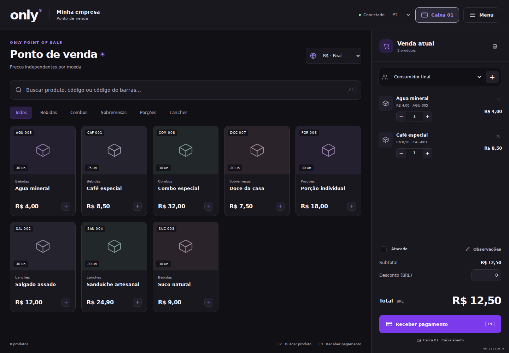

# ONLY — PDV & ERP

Sistema para operação de balcão, gestão da empresa, loja virtual e pedidos pelo celular. Identidade preta, branca e roxa, tema escuro inicial e marca discreta **onlysystem**. Cada empresa cria seu próprio espaço; não há dados ou conexão com o banco de outra loja.

## Abrir o sistema

Acesse **[ONLY no GitHub Pages](https://delta-1.github.io/ONLY/)**. O endereço abre a tela do aplicativo, usando o `index.html` da raiz, em vez de publicar o README como página inicial.

O Pages está conectado ao Supabase: escolha **Criar minha empresa**, informe seus dados e comece a cadastrar produtos. A função `only` processa autenticação, vendas, caixa e pedidos; o banco fica no esquema privado `only_app`, separado dos demais aplicativos do projeto WORKSPACE. Não há senha padrão. Cada empresa tem seus próprios usuários e dados.

Após mudar a estrutura da tela inicial, execute `npm run pages:build` para atualizar a entrada do Pages. Os links de loja, totem e cadastro colaborativo usam rotas `#/...`, compatíveis com o Pages. A configuração pública está em `public/site-config.json`; ela contém apenas a URL e a chave publicável. Chaves de serviço ficam exclusivamente no ambiente da função.

## Prévias

Telas de validação com produtos fictícios, sem dados de clientes.



[ERP](docs/screenshots/erp-desktop.png) · [Celular](docs/screenshots/pdv-mobile.png) · [Loja virtual móvel](docs/screenshots/loja-mobile.png) · [Tema claro](docs/screenshots/config-claro.png) · [Comprovante](docs/screenshots/comprovante.png)

## Executar localmente (opcional)

Requer **Node.js 24 ou superior**.

```sh
npm ci
npm start
```

Abra `http://localhost:3000`, escolha **Criar minha empresa** e cadastre o administrador. O banco começa vazio. Não há senha padrão nem conta compartilhada. Nos acessos seguintes, o aplicativo entra diretamente no PDV e pergunta se deseja abrir o caixa quando não há um caixa disponível.

```sh
npm run check
npm test
# Validação visual opcional:
npx playwright install chromium
npm run test:browser
```

## O que está disponível

- PDV com catálogo ou somente carrinho, pesquisa por nome/código, leitor de código de barras que funciona como teclado, Enter para adicionar, F2 para buscar, Esc para limpar e F9 para receber.
- Quantidades fracionárias, preço de atacado, desconto em valor, cliente e observações.
- Preços independentes em **BRL, BOB, USD e EUR**. Um campo de preço vazio desabilita a venda naquela moeda. O sistema não inventa conversões.
- Abertura opcional ao entrar: **Agora não** permite explorar e montar a venda. Receber pagamentos exige um caixa aberto na moeda da venda.
- Vários caixas simultâneos por empresa, cada um com nome, operador, moeda, saldo inicial, suprimento, sangria, saldo esperado, contagem e diferença no fechamento.
- Pagamento em dinheiro com troco imediato e no comprovante. Pix, QR, cartão, transferência e conta do cliente são meios de registro. Não há cobrança bancária automática.
- Pagamento parcial com confirmação explícita e cliente identificado, saldo a receber e recebimento posterior. Relatório considera o saldo pendente após recebimentos.
- Comprovante térmico, reimpressão, cancelamento com devolução do estoque e ajuste do caixa ainda aberto. A emissão fiscal não está integrada.
- ERP: produtos, clientes, estoque, pedidos, relatórios por período e moeda, exportação CSV e impressão/PDF pelo navegador.
- Personalização: logo da empresa, tema claro/escuro, modelos **Essencial** e **Clássico**, menu em grade/lista e exibição do catálogo no PDV.
- Interface em português, espanhol e inglês.
- Loja online com endereço próprio da empresa, QR Code, cópia e compartilhamento do link. Cliente monta o pedido sem login; o ERP recebe para atendimento e pagamento no PDV.
- Totem móvel por link, QR ou código digitado em `/join`. Quantos celulares forem necessários podem enviar pedidos para a mesma empresa.
- Cadastro colaborativo por link/QR com validade, revogação e aprovação dos produtos pelo administrador.
- Usuários de caixa com acesso próprio. Alterações de marca, produtos, equipe e links ficam com o administrador.
- Aplicativo web instalável (PWA) em navegadores compatíveis. Operação financeira depende de conexão com o servidor; nenhuma venda offline é indicada como salva.

## Fluxos

**Balcão:** entrar → PDV → abrir caixa ou escolher Agora não → adicionar itens → escolher cliente/desconto → receber → comprovante.

**Fechamento:** no PDV, Fechar caixa → informar dinheiro contado → conferir diferença → Confirmar fechamento. No celular, o botão também aparece na aba Venda atual.

**Gestão:** Menu → Gestão da empresa → produtos, clientes, pedidos, caixa, relatórios, equipe ou configurações.

**Pedido no celular:** Menu → Totem móvel → Criar link → compartilhar QR/link/código → cliente envia pedido → ERP / Pedidos → Levar ao PDV → receber.

**Loja virtual:** ERP → Loja virtual → ativar e salvar → compartilhar link. São exibidos os produtos ativos, publicados e com preço na moeda padrão.

**Produtos em conjunto:** ERP → Produtos → Cadastrar em conjunto → Criar link → auxiliar cadastra no celular → administrador aprova no ERP. O link não dá acesso a vendas, clientes ou relatórios.

## Produção: GitHub Pages + Supabase

A publicação usa o Pages para a interface e a função `only` no Supabase para os dados compartilhados. Não é necessário hospedar o processo Node para usar o endereço público.

- `supabase/migrations/20261023124825_only_cloud_backend.sql`: estrutura exclusiva do ONLY, permissões e gateway interno.
- `supabase/functions/only/`: função ativa e regras de negócio. O gateway SQL é acessível somente pela função com a credencial de serviço.
- `public/cloud.js`: transporte autenticado, restauração da sessão e geração dos links para o Pages.
- `public/site-config.json`: URL e chave publicável, sem credenciais privilegiadas.

As sessões são aleatórias, expiram após sete dias e têm apenas o hash armazenado no banco. As senhas usam PBKDF2-SHA256 com salt individual e 600.000 iterações. Operações concorrentes usam controle de versão no Postgres: a alteração inteira é gravada ou recalculada sobre os dados atuais, protegendo estoque e caixa. Reenvios de vendas preservam o identificador para evitar duplicação.

O parâmetro `verify_jwt=false` da função permite cadastro, login e catálogo antes de entrar. As rotas privadas validam a sessão própria do ONLY em cada chamada. As tabelas privadas não têm acesso anônimo, e `only_gateway` não concede execução aos papéis `anon` e `authenticated`.

## Alternativa: servidor Node com SQLite

O servidor Node permanece disponível como alternativa para uma instalação própria. Ele usa um banco SQLite separado do ambiente Supabase. Para essa alternativa, os aparelhos devem acessar a mesma instância Node com armazenamento persistente.

Para testar na mesma rede, abra `http://IP-DO-COMPUTADOR:3000` no computador antes de gerar o QR. Links gerados a partir de `localhost` só funcionam no próprio aparelho. Para produção e instalação PWA, use domínio com HTTPS.

Com Docker:

```sh
docker compose up -d --build
```

O volume `only-data` preserva os dados entre reinicializações. Use uma única instância do servidor para este arquivo SQLite; não use disco temporário nem várias réplicas com bancos independentes.

Variáveis:

| Variável | Valor padrão | Uso |
| --- | --- | --- |
| `PORT` | `3000` | Porta HTTP |
| `DATA_DIR` | `./data` | Diretório persistente do banco |
| `APP_ORIGIN` | Origem da requisição | URL pública completa, por exemplo `https://pdv.exemplo.com` |
| `COOKIE_SECURE` | `false` | Defina `true` com HTTPS em produção |

No proxy HTTPS, defina `APP_ORIGIN` e `COOKIE_SECURE=true`. O domínio deve apontar para a instância que mantém o volume. Os QR Codes usam essa origem. O frontend não contém credenciais de banco ou de outro sistema.

Veja [operação e publicação](docs/OPERACAO.md) e [verificação](docs/VERIFICACAO.md).

## Base dos projetos anteriores

A arquitetura foi simplificada para o ONLY e generalizada para quatro moedas e várias empresas. Foram reaproveitadas as regras de interpretação de valores e cálculo de troco de `Delta-1/FLORALIS.PDV`, commit `883512c3bef7bc11f069036dd2287029909ac4e6`, além dos ícones SVG. Os fluxos de catálogo/carrinho, conta do cliente e caixa seguem os projetos anteriores. Não é uma cópia integral do ERP antigo: este repositório não incorpora seu banco, migrações, logos, usuários ou rotinas específicas da loja original.

Única dependência de execução externa: `qrcode`, para gerar os QR Codes no próprio servidor. Interface sem framework e sem chamadas a CDNs ou serviços externos de QR.
